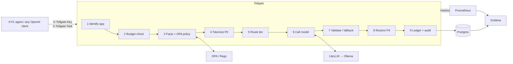

# Tollgate

**A governed LLM gateway for regulated AI workloads.** Every model request is costed,
policy-checked, PII-scrubbed, routed to the right model, and written to a tamper-evident
audit log. The gateway is demonstrated on a KYC / loan-document review agent.

[](https://github.com/piyushpatra-arch/tollgate/actions/workflows/ci.yml)
 

> Runs 100% locally with Ollama. No cloud account or API key needed.

## Why

Enterprises are putting LLMs into credit, claims, and customer workflows faster than they
can answer three basic questions:

1. **What is this costing, and who is spending it?** GenAI spend is invisible until the invoice.
2. **Is it allowed?** Which models are approved for which use cases, and what data may they see?
3. **Can we prove it?** Auditors want every decision, including the ones that were blocked.

Most organizations answer these with policy documents. Tollgate answers them **in the
request path**, as code, without changing the applications that call it.

## What it does

| Control | How | Where |
|---|---|---|
| **FinOps** | Per-call cost ledger, team budgets (soft warn / hard 429), chargeback by team and app. Local calls are priced against a cloud-equivalent catalog (*shadow pricing*). | [`finops/`](gateway/finops), [ADR-0003](docs/adr/0003-shadow-pricing-for-local-inference.md) |
| **Cost-aware routing** | Task-based routing (extract → small model, assess → large), with automatic fallback when the small model returns invalid JSON. | [`router.py`](gateway/pipeline/router.py), [ADR-0002](docs/adr/0002-rule-based-routing-with-fallback.md) |
| **Policy-as-code** | OPA/Rego decides: model approvals per risk tier, restricted-data rules per app, no protected attributes in credit decisions. Fails closed. | [`policies/`](policies), [ADR-0004](docs/adr/0004-policy-as-code-with-opa.md) |
| **PII protection** | Presidio detects PII. Values are swapped for consistent placeholder tokens before the model call and restored in the response. | [`pii.py`](gateway/pipeline/pii.py), [ADR-0005](docs/adr/0005-reversible-pii-tokenization.md) |
| **Tamper-evident audit** | Every request, allowed or denied, is recorded in a SHA-256 hash chain with no raw prompts. There is a one-command integrity check. | [`audit.py`](gateway/pipeline/audit.py), [ADR-0006](docs/adr/0006-hash-chained-audit-log.md) |
| **Observability** | Prometheus metrics and a provisioned Grafana dashboard: spend, routing mix, denials, latency, and the audit trail. | [`grafana/`](grafana) |

It exposes an **OpenAI-compatible API**, so existing apps point their `base_url` at Tollgate
and add two headers.

## Architecture



Full design, failure modes, and data model: [docs/architecture.md](docs/architecture.md).
Every significant decision is recorded in [docs/adr/](docs/adr).

## Quickstart (about 10 minutes)

**Prerequisites:** Docker, [Ollama](https://ollama.com), [uv](https://docs.astral.sh/uv/),
and `make`. 16 GB RAM is comfortable for the default models.

```bash
git clone https://github.com/<your-github-username>/tollgate && cd tollgate
cp .env.example .env
make models   # pulls a ~3B "small" and an ~8B "large" model into Ollama
make setup    # Python deps for the demo agent and tests
make up       # gateway :8080, Grafana :3000, Prometheus :9090, OPA :8181
make data     # 50 synthetic loan applicants with planted inconsistencies
make tour     # watch each control fire
```

Then open **http://localhost:3000**. The Tollgate dashboard is the home page.

To use different models, edit `config/models.yaml` and run `make models SMALL_MODEL=… LARGE_MODEL=…`.

## The governance tour

`make tour` sends requests that exercise every control. Example output (your costs will
differ with your models):

```
- Clean extraction routes to small model
    -> 200 tier=small $0.00032000
- SSN + name are redacted before the model sees them
    -> 200 tier=small $0.00032000 redacted={'PERSON': 1, 'US_SSN': 1}
- Protected attribute in a credit decision is blocked
    -> 403 policy_denied: [protected_attribute_in_credit_task] credit-decision tasks must not…
- Marketing app may not send restricted data
    -> 403 policy_denied: [restricted_data_not_approved] app 'marketing-copy' is not approved…
- High-risk app may not use an unvalidated model
    -> 403 policy_denied: [model_tier_not_approved] model tier 'experimental' is not approved…
- Low-risk app may use the experimental model
    -> 200 tier=experimental $0.00032000
- Sandbox team burns through its $0.01 budget
    -> request 33: 429 over_budget: team 'data-science' has used $0.0102 of its $0.01…
```

Then prove nothing was tampered with:

```bash
make verify-audit   # OK: audit chain intact (44 records)
make spend          # month-to-date spend by team vs budget
```

## The KYC demo and evaluation

The demo agent reviews each synthetic applicant in two steps. Every step goes through
Tollgate.

1. **Extract** (`task=extract`, small model): structured fields from the application, pay
   stub, bank statement, and ID record. SSNs, account numbers, and names are tokenized first.
2. **Assess** (`task=assess`, large model): cross-check the documents and flag income
   mismatch, address mismatch, name mismatch, and expired ID. The output is validated against
   a JSON Schema.

```bash
make review   # one applicant, with expected vs actual flags
make eval     # 20 applicants: cost-aware routing vs. sending everything to the large model
```

### Results

<!-- Run `make eval` and paste evals/results.md here. Publish what you measure. -->
_Run `make eval` on your hardware and paste `evals/results.md` here._

Shadow prices in `config/price_catalog.yaml` are **illustrative**. Update them from your
provider's pricing page before quoting numbers.

## Using Tollgate from your own code

```python
from openai import OpenAI

client = OpenAI(
    base_url="http://localhost:8080/v1",
    api_key="unused",  # Tollgate authenticates apps with X-Tollgate-Key
    default_headers={"X-Tollgate-Key": "tg-dev-kyc-review", "X-Tollgate-Task": "extract"},
)
resp = client.chat.completions.create(
    model="auto",  # the router chooses; send X-Tollgate-Tier to request a tier (policy permitting)
    messages=[{"role": "user", "content": "Extract the employer: Employer: Northwind Traders"}],
)
print(resp.choices[0].message.content)
```

Response headers carry `X-Tollgate-Request-Id`, `X-Tollgate-Model-Tier`,
`X-Tollgate-Shadow-Cost-USD`, and `X-Tollgate-Budget-State`.

## Configuration

| File | Controls |
|---|---|
| `config/apps.yaml` | Registered apps: team, risk tier, restricted-data approval, demo key |
| `config/budgets.yaml` | Monthly budget per team, soft-limit %, default limit |
| `config/models.yaml` | Tiers → LiteLLM model strings, task routing, fallback |
| `config/price_catalog.yaml` | Shadow prices per model class |
| `policies/tollgate.rego` | Approval, data, and fairness rules |

Moving a tier to the cloud means changing `litellm_model` to e.g. `bedrock/<model-id>` or
`azure/<deployment>` and supplying credentials. No code changes ([ADR-0007](docs/adr/0007-local-first-cloud-portable.md)).

## Tests

```bash
make test   # 30+ pytest tests (including real-OPA integration) + Rego unit tests
make lint   # ruff + mypy --strict
```

The suite covers each pipeline stage, fail-closed behavior, budget exhaustion, fallback
costing, PII never reaching the model, audit tamper and deletion detection, and an
architecture fitness test that keeps LiteLLM behind the provider interface.

## Known limitations (v1)

- The protected-attribute detector is a transparent **keyword scan**. It is conservative
  and produces false positives by design.
- NER uses spaCy's small English model. Some names will be missed or mis-bounded.
- The audit chain detects edits and deletions, but **not truncation of the newest records**
  without external head-hash anchoring. Appends assume a single gateway instance.
- No streaming. Static API keys. Single region, no HA.
- Policies are illustrative guardrails, **not legal or compliance advice**.

## Roadmap

- Bedrock / Azure OpenAI tiers with real-cost reconciliation against shadow estimates
- Classifier-based router trained on eval data
- Human-in-the-loop review queue for high-risk assessments
- PDF/OCR ingestion for real document images
- Governance for agent tool access (MCP): per-agent identity and least-privilege tools
- Model and agent registry with NIST AI RMF risk tiering
- Terraform module for a cloud deployment; audit head-hash anchoring to WORM storage

## How this was built

Tollgate is **architect-led and AI-assisted**. The architecture, ADRs, and guardrails were
written first. Implementation was done with an AI coding agent working under the
constraints in [`CLAUDE.md`](CLAUDE.md), then reviewed against the ADRs and the test suite.

## Data and disclaimer

All applicant data is synthetic (Faker). SSNs use the 9xx area range, which is never issued.
This project is a reference implementation for learning and discussion, not a production
compliance system.

## License

[MIT](LICENSE)
