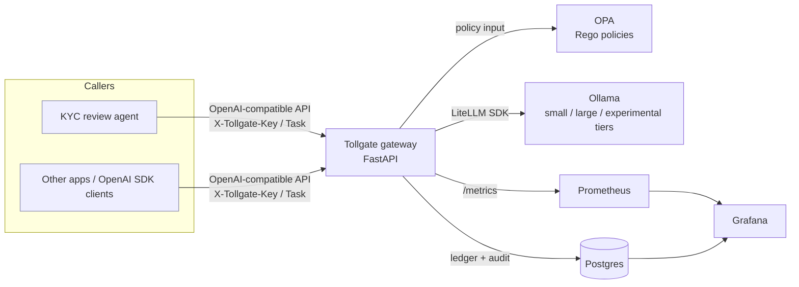
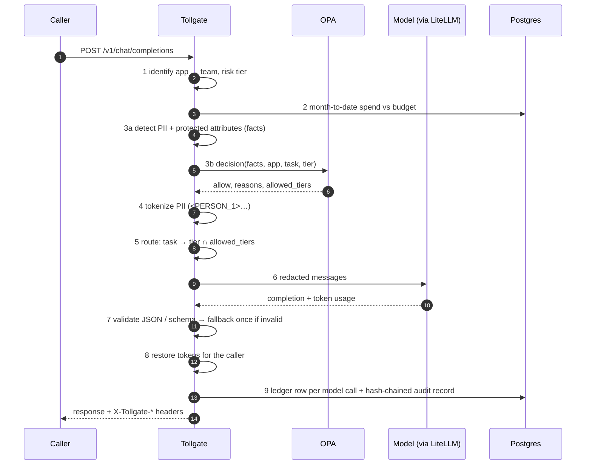

# Tollgate architecture

## Goals

1. **Every model request is governed in the request path**: costed, policy-checked,
   PII-scrubbed, routed, and audited, without changes to the calling application.
2. **Governance is inspectable**: prices, budgets, and routing in YAML; policies in tested
   Rego; decisions in a tamper-evident log.
3. **Runs free and local**, and moves to cloud models by configuration.

Non-goals for v1: streaming, multi-tenancy, high availability, production identity and
access management.

## Context

## Request pipeline

Stage order is an architectural decision. Nothing leaves the gateway until identity,
budget, and policy have passed, and nothing is audited with raw content.

Stage 9's audit write runs in a `finally` block, so denied, over-budget, and failed
requests are audited too.

## Failure behavior

| Failure | Behavior | HTTP | Audit outcome |
|---|---|---|---|
| Unknown or missing API key | Reject | 401 | `unauthenticated` |
| Team over hard budget | Reject before any tokens | 429 | `over_budget` |
| Ledger / budget store down | **Fail closed** | 503 | `budget_unavailable` |
| OPA down or no result | **Fail closed** | 503 | `policy_unavailable` |
| Policy deny | Reject, list reason IDs | 403 | `policy_denied` |
| Unknown tier override | Reject | 400 | `unknown_tier` |
| Model unreachable | Reject | 502 | `model_unavailable` |
| Invalid JSON after fallback | Reject | 502 | `invalid_model_output` |

## Data model

**`cost_ledger`**: one row per *model call* (fallback = two rows): team, app, task, tier,
model, token counts, `actual_cost_usd`, `shadow_cost_usd`, latency, `is_fallback`. This is
the FinOps system of record, used for budgets, chargeback, and the Grafana spend table.

**`audit_log`**: one row per *request*: outcome, status, tiers used, policy reason IDs,
PII entity counts (input and new-in-output), protected-attribute categories, prompt and
response SHA-256, tokens, cost, `prev_hash`, `record_hash`. No raw content.

Prometheus counters mirror these for real-time dashboards and reset on restart. Postgres is
authoritative.

## Security and privacy notes

- Raw prompts and responses are never persisted or logged. The PII token map exists only in
  memory for one request.
- Demo API keys live in `config/apps.yaml` for convenience. Production would use a secrets
  manager and workload identity.
- All demo data is synthetic (Faker; SSNs in the never-issued 9xx range).
- Policies are illustrative guardrails, not legal or compliance advice.

## Path to cloud

| Concern | v1 (local) | Cloud evolution |
|---|---|---|
| Models | Ollama via LiteLLM | `bedrock/…` or `azure/…` in `config/models.yaml`; real `actual_cost_usd` |
| Policy | OPA sidecar, local files | OPA with signed bundles from a policy repo |
| Ledger / audit | Postgres container | Managed Postgres; head-hash anchoring to WORM storage |
| Metrics | Prometheus + Grafana | Managed Prometheus/Grafana or CloudWatch/Azure Monitor via OTel |
| Identity | Static keys | API gateway + OIDC / workload identity |

See `docs/adr/` for the decisions behind each choice.
